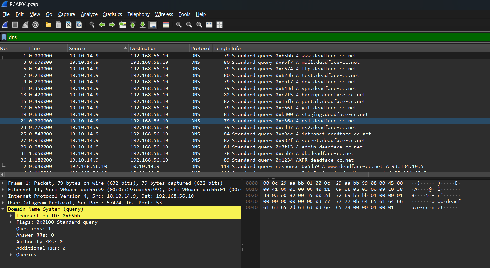
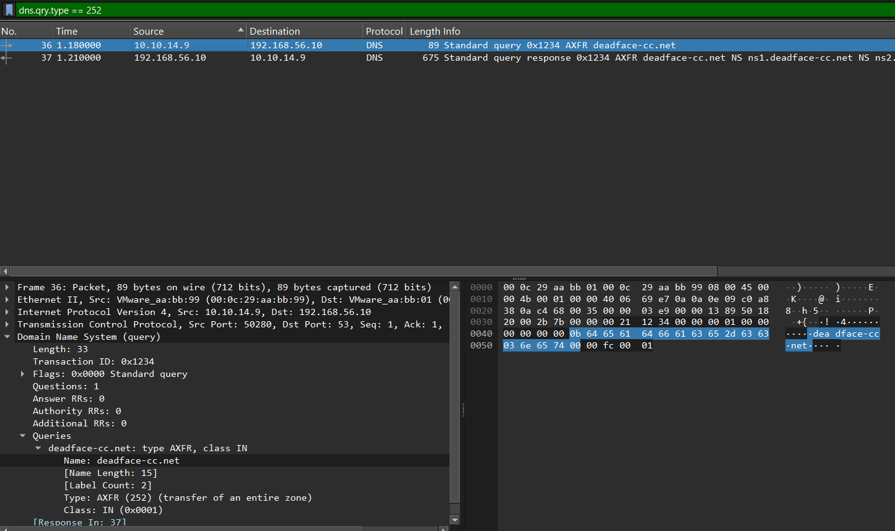
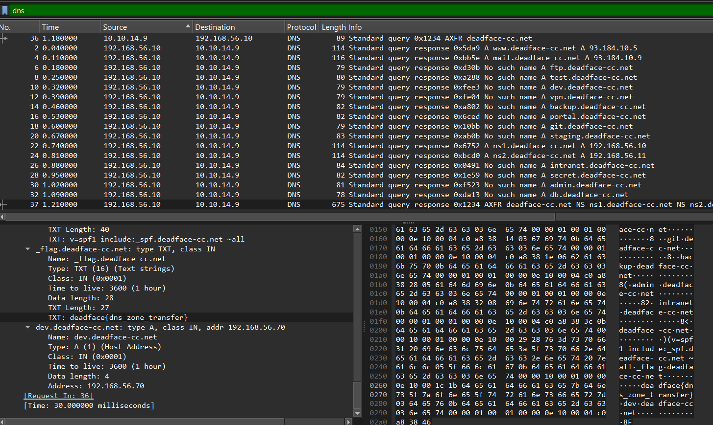

# DEADFACE CTF 2026 — Twilight Zone Transfer Write-Up

- **Challenge:** Twilight Zone Transfer
- **Category:** Network Forensics / DNS
- **Evidence file:** `PCAP04.pcap`
- **Objective:** Inspect DNS traffic, identify an attempted DNS zone transfer, and recover the relevant challenge data.

---

## 1. Challenge Overview

This challenge is investigated using a packet capture (`PCAP04.pcap`). The capture contains DNS requests and responses between `10.10.14.9` and `192.168.56.10`.

The main lead is a DNS **AXFR** request for the `deadface-cc.net` domain. AXFR is a DNS query type used to request a full copy of a DNS zone from an authoritative DNS server. If zone transfers are not restricted, they can disclose hostnames and other DNS records that should not necessarily be exposed to an arbitrary client.

## 2. Initial PCAP Review

The capture contains 40 packets. The visible traffic is DNS over UDP and TCP, using port 53.

The primary endpoints are:

| Address | Observed role in this capture |
|---|---|
| `10.10.14.9` | DNS client issuing queries |
| `192.168.56.10` | DNS server responding to queries and the AXFR request |

Most of the early packets are ordinary `A` queries for names under `deadface-cc.net`, including `www`, `mail`, `ftp`, `test`, `dev`, `vpn`, `backup`, `portal`, `git`, `staging`, `ns1`, `ns2`, `intranet`, `secret`, `admin`, and `db`.

Several names return successful address records, while others receive negative responses. The unusual traffic is the later TCP DNS request for a full zone transfer.

**Evidence 1 — Initial DNS traffic:** The following Wireshark screenshot shows the DNS queries and responses observed in the capture.



## 3. Identifying the DNS Zone Transfer

The key query requests an **AXFR** transfer for:

```text
deadface-cc.net
```

The AXFR request is sent from `10.10.14.9` to `192.168.56.10` over TCP port 53. The server responds with DNS records for the zone.

In Wireshark, this activity can be located with the display filter:

```text
dns.qry.type == 252
```

The numeric DNS query type `252` corresponds to AXFR. To narrow the view to DNS over TCP, use:

```text
tcp.port == 53
```

This request is significant because it attempts to retrieve the zone's records in bulk instead of querying one hostname at a time.

**Evidence 2 — AXFR request:** The screenshot below shows the AXFR query for `deadface-cc.net`, including query type `AXFR (252)` and the corresponding response reference.



## 4. Examining the Transferred Records

The zone-transfer response exposes several records, including the authoritative name servers and internal-looking hostnames.

Examples observed in the response include:

| DNS name | Record | Value |
|---|---|---|
| `deadface-cc.net` | `NS` | `ns1.deadface-cc.net` |
| `deadface-cc.net` | `NS` | `ns2.deadface-cc.net` |
| `ns1.deadface-cc.net` | `A` | `192.168.56.10` |
| `ns2.deadface-cc.net` | `A` | `192.168.56.11` |
| `vpn.deadface-cc.net` | `A` | `192.168.56.20` |
| `git.deadface-cc.net` | `A` | `192.168.56.30` |
| `backup.deadface-cc.net` | `A` | `192.168.56.40` |
| `admin.deadface-cc.net` | `A` | `192.168.56.50` |
| `intranet.deadface-cc.net` | `A` | `192.168.56.60` |
| `dev.deadface-cc.net` | `A` | `192.168.56.70` |

These records reveal hostnames and addressing information that could help an analyst map the domain's infrastructure.

## 5. Recovering the TXT Record

One particularly important record in the AXFR response is the TXT record associated with `_flag.deadface-cc.net`.

The record's value is:

```text
deadface{dns_zone_transfer}
```

TXT records can contain arbitrary text and are often used for domain configuration, verification, and policy data. In this capture, the `_flag` TXT record contains the challenge flag.

To inspect this in Wireshark, select the AXFR response and expand the DNS answer section. Look for the TXT record whose name is `_flag.deadface-cc.net`.

**Evidence 3 — TXT record containing the flag:** The selected AXFR response displays the `_flag.deadface-cc.net` TXT record and its value.



## 6. Flag Construction

The flag is provided directly in the TXT record, so no further assembly is needed.

**Final flag:**

```text
deadface{dns_zone_transfer}
```

## 7. Key Takeaways

1. **Inspect DNS over both UDP and TCP.** DNS zone transfers commonly use TCP, so reviewing only UDP traffic can miss important evidence.
2. **Look for AXFR queries.** An AXFR request can reveal an entire DNS zone when the server permits the transfer.
3. **Review all record types.** TXT records can hold important text in addition to the more familiar `A` and `NS` records.
4. **Understand the exposure.** An unrestricted zone transfer can disclose hostnames and internal network structure.
5. **Use evidence from the capture.** The flag in this write-up comes from the `_flag.deadface-cc.net` TXT record visible in the AXFR response.

## References

- [RFC 5936 — DNS Zone Transfer Protocol (AXFR)](https://www.rfc-editor.org/rfc/rfc5936)
- [Wireshark Display Filter Reference — DNS](https://www.wireshark.org/docs/dfref/d/dns.html)
